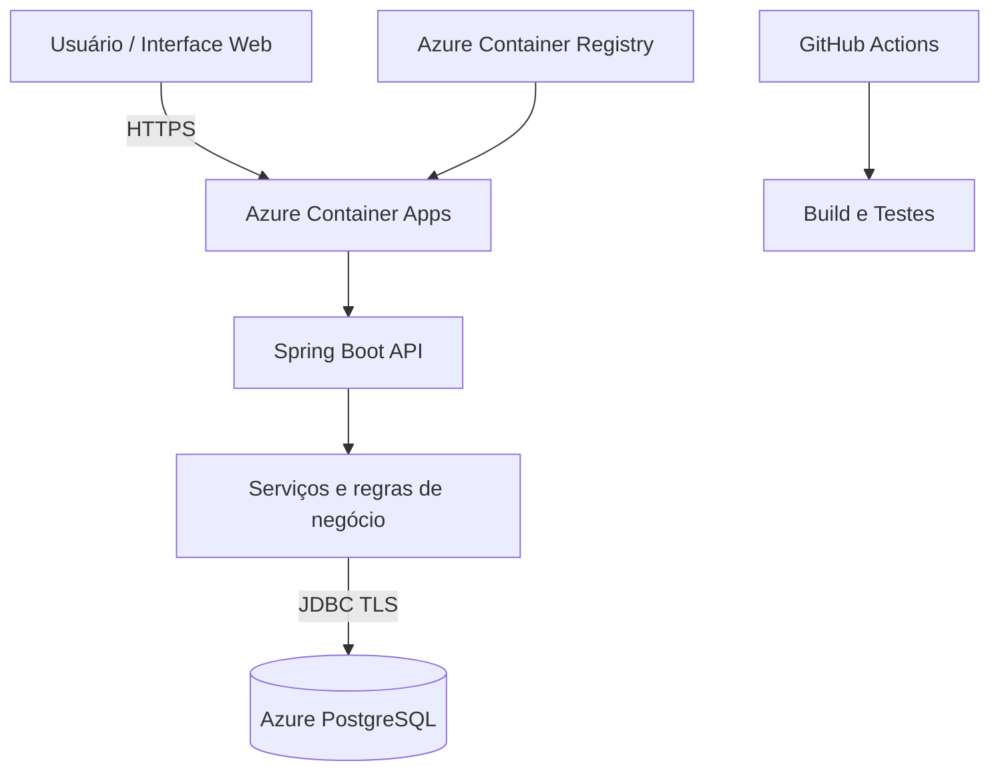

# ♻️ Reaproveita+

### Tecnologia que conecta alimentos a quem precisa.

**FIAP Global Solution 2026 — CitizenTech**

O **Reaproveita+** é uma plataforma web para conectar organizações que possuem excedentes de alimentos a instituições que podem recebê-los, promovendo a redistribuição responsável e contribuindo para a redução do desperdício alimentar.

## Sobre o projeto

O desperdício de alimentos e a dificuldade de conectar doadores e instituições receptoras representam desafios importantes para cidades e comunidades.

O Reaproveita+ propõe uma solução digital para facilitar o cadastro de doações, a identificação de receptores compatíveis e o acompanhamento de reservas e retiradas.

**ODS relacionados:** ODS 2 — Fome Zero; ODS 12 — Consumo e Produção Responsáveis.

## Funcionalidades

- Cadastro e autenticação de usuários com diferentes perfis.
- Gerenciamento de organizações doadoras e receptoras.
- Cadastro, consulta e gerenciamento de doações.
- Perfis receptores com capacidade e categorias aceitas.
- Recomendações por compatibilidade, proximidade, urgência e disponibilidade.
- Solicitação, confirmação e cancelamento de reservas.
- Registro de retirada de alimentos.
- Controle de permissões e validação das operações.
- Interface web e API REST.

## Tecnologias utilizadas

| Camada | Tecnologias |
|---|---|
| Backend | Java 21, Spring Boot 4.1.2 |
| Interface | Thymeleaf, HTML, CSS |
| Segurança | Spring Security, HTTP Basic, BCrypt |
| Persistência | Spring Data JPA, Hibernate |
| Banco de dados | PostgreSQL 16 |
| Migrações | Flyway |
| Testes | JUnit, Maven Surefire, JaCoCo |
| Containers | Docker, Docker Compose |
| Cloud | Microsoft Azure |
| CI | GitHub Actions |

## Arquitetura

A aplicação está implantada no **Azure Container Apps**, utilizando banco de dados PostgreSQL gerenciado e imagem Docker armazenada no Azure Container Registry.

## Demonstração

**Aplicação publicada:**

https://reaproveita-plus-app.delightfulocean-71f5cddf.francecentral.azurecontainerapps.io

**Health check:**

https://reaproveita-plus-app.delightfulocean-71f5cddf.francecentral.azurecontainerapps.io/actuator/health

A disponibilidade dos serviços depende do estado dos recursos Azure.

## Recomendações inteligentes

O sistema utiliza regras de elegibilidade e uma pontuação de compatibilidade considerando:

| Critério | Peso |
|---|---:|
| Proximidade geográfica | 35% |
| Compatibilidade | 30% |
| Urgência | 20% |
| Disponibilidade | 15% |

No cenário de teste realizado na Azure, o sistema recomendou uma organização receptora com **score 84/100** e distância aproximada de **0,84 km**.

O mecanismo atual é determinístico, não um modelo de IA generativa ou machine learning.

## Qualidade e testes

As evidências da fase de testes automatizados registraram:

- **42 testes aprovados**
- **0 falhas**
- **89,17% de cobertura de linhas JaCoCo**

Também foram validados na Azure os fluxos de cadastro, autenticação, doação, recomendações, reserva, confirmação e retirada.

## Documentação

- [Implantação na Azure](docs/DEPLOY_AZURE.md)
- [Endpoints da API](docs/API_ENDPOINTS.md)
- [Preparação inicial para Azure](docs/AZURE_PREPARACAO.md)
- [Evidências técnicas anteriores](docs/EVIDENCIAS_ETAPA11.md)
- [Documentação da Etapa 11](README_ETAPA11.md)

## Segurança e limitações

A aplicação utiliza autenticação e regras de autorização, comunicação externa HTTPS e conexão JDBC com verificação TLS.

**Atenção:** o ambiente Azure é uma demonstração acadêmica. A regra temporária de acesso ao PostgreSQL deve ser substituída por uma configuração de rede mais restritiva antes de qualquer utilização em produção.

## Próximas melhorias

- Conectividade privada entre aplicação e banco.
- Monitoramento, alertas e recuperação de falhas.
- Evolução da experiência do usuário.
- Melhorias de acessibilidade.
- Possível integração de IA para apoio à categorização de alimentos.
- Indicadores de impacto e redistribuição alimentar.

## Autor

**Marcus Vinicius de Souza Calazans**  
FIAP — Análise e Desenvolvimento de Sistemas  
RM 556620

**Projeto acadêmico — Global Solution 2026 / CitizenTech**