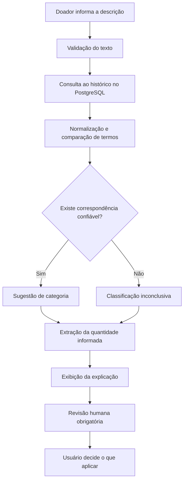
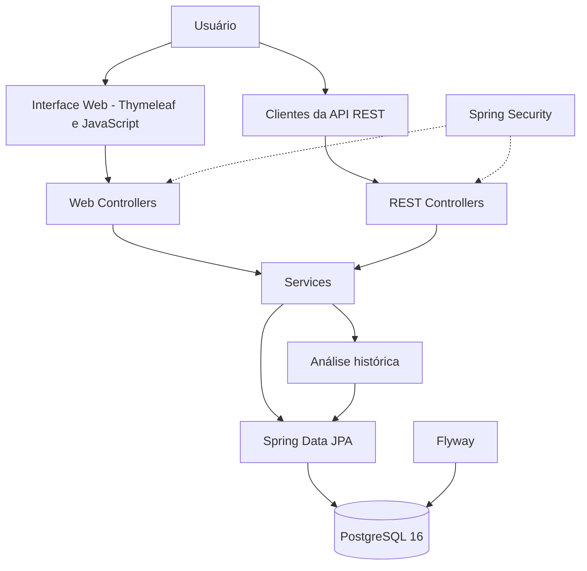
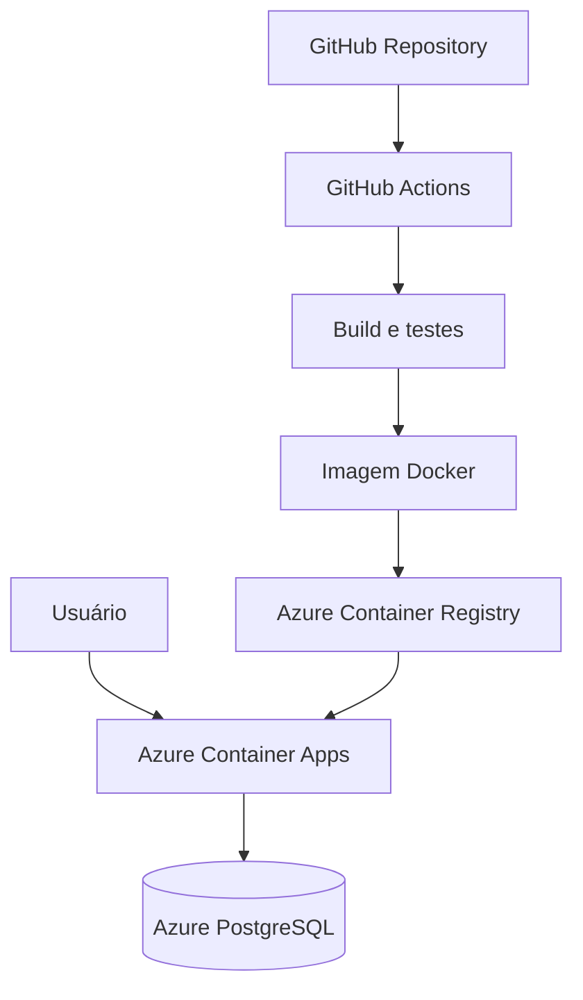


<div align="center">

# ♻️ Reaproveita+

### Tecnologia que conecta alimentos a quem precisa.

**FIAP Global Solution 2026 — CitizenTech**

Plataforma inteligente para redistribuição de excedentes alimentares, conectando organizações doadoras a instituições receptoras.

<br>


<br>

[](https://github.com/calazans-999/reaproveita-plus)
[](https://github.com/calazans-999/reaproveita-plus/pull/1)


</div>

---

## 📖 Sobre o projeto

O **Reaproveita+** é uma plataforma web desenvolvida para reduzir o desperdício alimentar por meio da conexão entre organizações que possuem excedentes de alimentos e instituições que podem recebê-los.

A aplicação permite gerenciar doações, identificar organizações receptoras compatíveis, recomendar destinos com base em critérios objetivos e acompanhar as etapas de reserva e retirada.

O projeto também possui um mecanismo de **análise histórica de alimentos**, que auxilia o doador na classificação de novas doações utilizando informações registradas anteriormente no PostgreSQL.

### O problema

O desperdício de alimentos representa um desafio social, econômico e ambiental.

Ao mesmo tempo, diversas instituições enfrentam dificuldades para receber doações de maneira organizada, previsível e compatível com suas necessidades.

O Reaproveita+ busca aproximar esses dois lados utilizando tecnologia, regras de negócio e mecanismos de recomendação.

### Nossa proposta

- Facilitar o cadastro de doações alimentares.
- Conectar organizações doadoras e receptoras.
- Identificar receptores compatíveis com cada oferta.
- Priorizar critérios de proximidade, urgência e disponibilidade.
- Organizar reservas, confirmações e retiradas.
- Apoiar a classificação dos alimentos por análise histórica.
- Contribuir para a redução do desperdício.

### Objetivos de Desenvolvimento Sustentável

| ODS | Contribuição |
|---|---|
| **ODS 2 — Fome Zero** | Facilitar o acesso de organizações sociais a excedentes alimentares. |
| **ODS 12 — Consumo e Produção Responsáveis** | Promover o reaproveitamento e a redistribuição responsável de alimentos. |

---

## ✨ Funcionalidades

### 👤 Usuários e autenticação

- Cadastro de usuários.
- Autenticação com Spring Security.
- Armazenamento de senhas com BCrypt.
- Separação de permissões por perfil.
- Login web com sessão e proteção CSRF.
- Autenticação HTTP Basic para a API REST.

**Perfis disponíveis:**

| Perfil | Responsabilidade |
|---|---|
| `ADMIN` | Administração e operações autorizadas do sistema. |
| `DONOR` | Cadastro e gerenciamento de organizações e doações. |
| `RECEIVER` | Gerenciamento de organizações receptoras e recebimento de doações. |

### 🏢 Organizações

- Cadastro de organizações doadoras e receptoras.
- Consulta e atualização de dados.
- Associação das organizações aos usuários responsáveis.
- Registro de cidade e coordenadas geográficas.
- Controle de acesso por proprietário e perfil.
- Proteção contra exclusão de organizações com registros vinculados.

### 🍎 Doações alimentares

- Cadastro e gerenciamento de doações.
- Descrição e categorização de alimentos.
- Registro da quantidade em quilogramas.
- Data de validade e condições de conservação.
- Declaração sobre requisitos sanitários.
- Controle do estado das doações.
- Consulta de ofertas disponíveis.

**Categorias suportadas:**

| Código | Categoria |
|---|---|
| `FRUITS` | Frutas |
| `VEGETABLES` | Vegetais |
| `BAKERY` | Produtos de panificação |
| `GRAINS` | Grãos e cereais |
| `OTHER` | Outros alimentos |

### 📦 Reservas e retiradas

- Solicitação de reservas.
- Validação de disponibilidade.
- Prevenção de reservas duplicadas.
- Confirmação e cancelamento.
- Registro de retirada.
- Restrições conforme o perfil e as regras de negócio.

### 🎯 Recomendações para organizações receptoras

O sistema utiliza critérios de elegibilidade e pontuação para sugerir organizações receptoras compatíveis.

| Critério | Peso |
|---|---:|
| Proximidade geográfica | 35% |
| Compatibilidade | 30% |
| Urgência | 20% |
| Disponibilidade | 15% |
| **Total** | **100%** |

Em um cenário anteriormente validado na Azure, o mecanismo apresentou uma recomendação com **84/100 pontos**, considerando uma distância aproximada de **0,84 km**.

Esse mecanismo utiliza regras determinísticas, não um modelo generativo.

---

## 🧠 Análise histórica de alimentos

Uma das funcionalidades desenvolvidas para o projeto é o mecanismo de apoio à classificação de doações com base no histórico armazenado no PostgreSQL.

O recurso auxilia o doador na identificação da categoria e da quantidade informada na descrição do alimento.

### Como funciona?



### Etapas do processamento

**1. Entrada da descrição**

O usuário informa uma descrição textual, por exemplo:

> Tenho 8 kg de pães integrais para doar.

**2. Normalização**

O sistema realiza operações de processamento de texto, incluindo:

- Conversão para letras minúsculas.
- Remoção de acentos.
- Eliminação de palavras genéricas.
- Tratamento básico de singular e plural.
- Identificação de palavras relevantes.

**3. Comparação histórica**

A descrição é comparada com títulos de doações registradas anteriormente.

O mecanismo identifica termos compartilhados e avalia as correspondências por categoria.

**4. Identificação da categoria**

Quando existe uma correspondência suficientemente clara, o sistema sugere uma categoria.

Quando existem correspondências conflitantes ou nenhuma correspondência adequada, a análise é considerada inconclusiva.

**5. Extração da quantidade**

Quando o usuário informa uma quantidade em quilogramas, o sistema tenta identificá-la.

A quantidade não é estimada a partir das doações anteriores.

**6. Revisão humana**

O sistema apresenta a sugestão, mas não publica a doação automaticamente.

O usuário precisa conferir as informações antes de utilizá-las.

### Exemplos validados

| Descrição | Resultado | Quantidade |
|---|---|---:|
| Tenho 8 kg de pães integrais | `BAKERY` | 8 kg |
| Tenho 5 kg de bananas maduras | `FRUITS` | 5 kg |
| Tenho 10 kg de cenouras frescas | `VEGETABLES` | 10 kg |
| Tenho 20 kg de arroz branco | `GRAINS` | 20 kg |
| Tenho 6 kg de leite em pó lacrado | `OTHER` | 6 kg |
| Tenho 8 kg de pães e bananas | Classificação inconclusiva | 8 kg |

Os exemplos representam cenários de validação, não uma avaliação estatística de precisão do classificador.

### Tratamento de ambiguidades

O mecanismo busca evitar a escolha arbitrária de uma categoria quando a descrição contém alimentos diferentes ou evidências conflitantes.

**Exemplo:**

> Tenho 8 kg de pães e bananas.

Nesse caso, o sistema apresenta:

- Classificação inconclusiva.
- Quantidade identificada: 8 kg.
- Explicação sobre a ambiguidade.
- Possibilidade de aplicar somente a quantidade.
- Necessidade de selecionar manualmente a categoria.

### Explicabilidade

Quando encontra correspondências, o sistema apresenta os termos identificados no histórico.

Assim, o usuário consegue compreender por que determinada categoria foi sugerida.

### Limitações técnicas

**O analisador histórico não utiliza IA generativa, modelos de linguagem ou machine learning.**

A implementação atual utiliza:

- Regras determinísticas.
- Normalização textual.
- Similaridade por correspondência de termos.
- Histórico de doações no PostgreSQL.
- Tratamento de resultados ambíguos.
- Revisão humana obrigatória.

A precisão depende da diversidade e qualidade dos registros históricos.

O mecanismo não avalia automaticamente a segurança sanitária de um alimento, sua validade real ou suas condições efetivas de conservação.

---

## 🏗️ Arquitetura

O projeto utiliza uma arquitetura em camadas, com responsabilidades separadas entre interface, controllers, serviços, repositórios e banco de dados.



### Organização técnica

| Camada | Responsabilidade |
|---|---|
| `controller` | Endpoints REST e respostas HTTP. |
| `web` | Fluxos da interface web. |
| `service` | Regras de negócio e processamento. |
| `repository` | Persistência e consultas. |
| `model` | Entidades e enumerações. |
| `dto` | Contratos de entrada e saída. |
| `security` | Autenticação e autorização. |
| `templates` | Páginas Thymeleaf. |
| `static` | Recursos CSS e JavaScript. |

### Componentes da análise histórica

| Arquivo | Responsabilidade |
|---|---|
| `HistoricalFoodAnalysisClient.java` | Comparação com registros históricos. |
| `AiFoodAnalysisService.java` | Validação e orquestração da análise. |
| `AiModelClient.java` | Contrato da implementação de análise. |
| `AiFoodAnalysisController.java` | Endpoint REST. |
| `AiDonationWebController.java` | Endpoint utilizado pela interface web. |
| `ai-donation.js` | Painel de sugestões e aplicação manual. |

Os nomes `AiFoodAnalysis` e `AiModelClient` foram mantidos por compatibilidade com a estrutura de código existente. A implementação utilizada nesta versão é histórica e determinística.

---

## 🛠️ Tecnologias

| Camada | Tecnologias |
|---|---|
| Linguagem | Java 21 |
| Framework | Spring Boot 4.1.2 |
| Segurança | Spring Security e BCrypt |
| Interface | Thymeleaf, HTML, CSS e JavaScript |
| API | REST e JSON |
| Persistência | Spring Data JPA e Hibernate |
| Banco de dados | PostgreSQL 16 |
| Migrações | Flyway |
| Testes | JUnit 5, Mockito e Spring Boot Test |
| Qualidade | Maven Surefire e JaCoCo |
| Infraestrutura | Docker e Docker Compose |
| Nuvem | Microsoft Azure |
| Integração contínua | GitHub Actions |
| Versionamento | Git e GitHub |

---

## 🚀 Executando localmente

### Pré-requisitos

- Java 21.
- Docker Desktop.
- Git.
- PowerShell ou terminal compatível.
- Maven Wrapper disponível no repositório.

### 1. Clonar o repositório

```bash
git clone https://github.com/calazans-999/reaproveita-plus.git
cd reaproveita-plus
```

### 2. Selecionar a branch da análise histórica

```bash
git checkout feature/ai-food-classification
```

Essa branch contém a implementação de análise histórica enquanto o Pull Request #1 estiver pendente de integração à `main`.

### 3. Configurar o ambiente

Consulte os arquivos de exemplo de configuração existentes no repositório:

- `.env.example`
- `.env.etapa10.example`

Configure as variáveis necessárias para o perfil local utilizado.

Não adicione senhas ou tokens reais ao Git.

### 4. Iniciar o PostgreSQL

Inicie o contêiner do PostgreSQL conforme a configuração Docker do projeto.

No ambiente local utilizado durante o desenvolvimento:

| Parâmetro | Valor |
|---|---|
| Contêiner | `reaproveita-postgres` |
| Versão | PostgreSQL 16 |
| Porta local | `5434` |
| Banco | `reaproveita` |

Verifique:

```powershell
docker ps
```

As credenciais devem ser obtidas da configuração local do ambiente.

### 5. Iniciar o Spring Boot

No Windows:

```powershell
.\mvnw.cmd spring-boot:run
```

No Linux ou macOS:

```bash
./mvnw spring-boot:run
```

A aplicação deve utilizar o perfil e as configurações adequados ao ambiente local.

Na configuração utilizada durante os testes de desenvolvimento, a interface foi acessada por:

http://localhost:8082/login

### 6. Acessar as doações

Após autenticar-se com um usuário do perfil `DONOR`, acesse:

http://localhost:8082/donations

A funcionalidade **Analisar histórico** está disponível no formulário de cadastro de doações.

---

## 🗃️ Dados demonstrativos

O projeto disponibiliza um script opcional para popular o banco local com registros fictícios:

`scripts/Popular_Dados_Demo.sql`

### Conteúdo da demonstração

| Tipo de registro | Quantidade |
|---|---:|
| Organizações doadoras fictícias | 5 |
| Organizações receptoras fictícias | 5 |
| Doações fictícias | 5 |
| Categorias representadas | 5 |

O script utiliza usuários demonstrativos existentes no banco utilizado durante o desenvolvimento. Portanto, requer a presença dos identificadores e perfis esperados.

A execução deve ocorrer somente em um ambiente local preparado especificamente para isso.

**Não execute esse script em produção.**

Os registros são fictícios e não representam alimentos disponíveis para consumo ou retirada.

O script foi criado para evitar duplicações dos registros demonstrativos quando executado novamente no ambiente previsto.

---

## 🔌 API REST

A plataforma disponibiliza endpoints para autenticação, organizações, doações, reservas e recomendações.

### Análise histórica de alimentos

**Método:** `POST`

**Endpoint:**

```http
POST /api/v1/ai/analyze-donation
```

**Autenticação:** HTTP Basic.

**Perfis autorizados:** `DONOR` e `ADMIN`.

Exemplo de requisição:

```json
{
  "description": "Tenho 8 kg de paes integrais"
}
```

Exemplo ilustrativo de resposta:

```json
{
  "category": "BAKERY",
  "quantityKg": 8,
  "storageCondition": null,
  "explanation": "Categoria sugerida com base em doacoes semelhantes no historico.",
  "requiresReview": true
}
```

A explicação real é produzida conforme as correspondências encontradas no banco de dados.

A interface web utiliza um endpoint próprio:

```http
POST /donations/ai/analyze
```

Esse fluxo utiliza autenticação web e proteção CSRF.

### Documentação dos demais endpoints

Consulte:

[docs/API_ENDPOINTS.md](docs/API_ENDPOINTS.md)

---

## 🧪 Testes e qualidade

O Reaproveita+ possui testes automatizados para regras de negócio, segurança, endpoints REST, integração e análise histórica.

### Resultado mais recente

| Métrica | Resultado |
|---|---:|
| Testes executados | **71** |
| Testes aprovados | **71** |
| Falhas | **0** |
| Erros | **0** |
| Ignorados | **0** |
| Build Maven | **SUCCESS** |

**Última execução local confirmada:** 18/11/2026.

### Cobertura de testes

Uma execução anterior do projeto registrou **89,17% de cobertura de linhas com JaCoCo**.

Esse valor é histórico e deve ser recalculado para representar a versão atual de 71 testes.

### Cenários do analisador histórico

Os testes específicos verificam:

1. Classificação de produtos de panificação.
2. Comportamento com histórico vazio.
3. Ausência de quantidade informada.
4. Exclusão de doações canceladas da comparação.
5. Tratamento de singular e plural.
6. Identificação de descrições ambíguas.
7. Tratamento de alimentos desconhecidos.
8. Explicação dos termos encontrados.

### Executar todos os testes

Windows:

```powershell
.\mvnw.cmd clean verify
```

Linux ou macOS:

```bash
./mvnw clean verify
```

### Executar os testes do analisador

```powershell
.\mvnw.cmd -Dtest=HistoricalFoodAnalysisClientTests test
```

O projeto também possui testes de integração para cenários de sucesso, falha, autenticação, autorização e validação das requisições.

---

## ☁️ Infraestrutura e Azure

O projeto possui uma implantação acadêmica baseada em serviços da Microsoft Azure.

### Serviços utilizados

- Azure Container Apps.
- Azure Container Registry.
- Azure Database for PostgreSQL.
- GitHub Actions.
- Docker.

### Arquitetura de implantação



### Aplicação publicada

[Reaproveita+ — Azure Container Apps](https://reaproveita-plus-app.delightfulocean-71f5cddf.francecentral.azurecontainerapps.io)

### Health check

[Verificar saúde da aplicação](https://reaproveita-plus-app.delightfulocean-71f5cddf.francecentral.azurecontainerapps.io/actuator/health)

A disponibilidade depende do estado dos recursos Azure.

### Situação da nova funcionalidade

A análise histórica foi implementada, testada e enviada para a branch:

`feature/ai-food-classification`

A funcionalidade está em revisão no:

[Pull Request #1](https://github.com/calazans-999/reaproveita-plus/pull/1)

**A implantação existente na Azure não foi atualizada com essa funcionalidade durante esta etapa.**

Portanto, a versão publicada pode apresentar funcionalidades diferentes das disponíveis na branch de desenvolvimento.

---

## 🔐 Segurança

O sistema implementa mecanismos de autenticação e autorização para proteger operações e recursos.

### Proteções existentes

- Senhas armazenadas com BCrypt.
- Spring Security.
- Autenticação HTTP Basic na API.
- Login por formulário na interface web.
- Proteção CSRF nas requisições web.
- Verificação de permissões por perfil.
- Restrições de acesso a organizações de terceiros.
- Validação de dados de entrada.
- Tratamento de erros sem exposição intencional de detalhes internos.
- Comunicação HTTPS e conexão TLS no ambiente Azure configurado.

### Cuidados operacionais

O projeto é um MVP acadêmico e não deve ser considerado pronto para operação comercial sem avaliações adicionais.

Antes de uma utilização real, são necessários:

- Revisão das regras de rede e acesso ao banco.
- Gestão apropriada de segredos.
- Monitoramento e alertas.
- Testes adicionais de segurança.
- Auditoria de permissões e dados.
- Validação das regras sanitárias aplicáveis.
- Plano de backup e recuperação.

**Observação:** o ambiente Azure de demonstração utiliza uma regra temporária de acesso ao PostgreSQL que precisa ser restringida antes de utilização em produção.

---

## 📚 Documentação

| Documento | Conteúdo |
|---|---|
| [Deploy Azure](docs/DEPLOY_AZURE.md) | Processo de implantação e infraestrutura. |
| [API Endpoints](docs/API_ENDPOINTS.md) | Referência dos endpoints REST. |
| [Preparação Azure](docs/historico/AZURE_PREPARACAO.md) | Histórico da configuração inicial. |
| [Evidências Etapa 11](docs/historico/EVIDENCIAS_ETAPA11.md) | Evidências técnicas anteriores. |
| [README Etapa 11](docs/historico/README_ETAPA11.md) | Documentação de etapa anterior. |

---

## 🛣️ Roadmap

### Implementado

- [x] Autenticação e autorização.
- [x] Cadastro de organizações.
- [x] Gerenciamento de doações.
- [x] Perfis receptores.
- [x] Reservas e retiradas.
- [x] Recomendações de organizações receptoras.
- [x] Interface web e API REST.
- [x] Integração com PostgreSQL.
- [x] Migrações Flyway.
- [x] Containerização Docker.
- [x] Implantação acadêmica na Azure.
- [x] Testes automatizados.
- [x] Analisador histórico de alimentos na branch de desenvolvimento.
- [x] Detecção de classificações ambíguas.
- [x] Painel de recomendações com revisão humana.

### Melhorias futuras

- [ ] Evoluir a análise textual e ampliar a cobertura de alimentos.
- [ ] Medir a precisão do classificador com conjuntos de avaliação.
- [ ] Otimizar as consultas históricas para bases maiores.
- [ ] Implementar métricas de impacto social.
- [ ] Criar dashboards de doações e redistribuição.
- [ ] Aprimorar a acessibilidade da interface.
- [ ] Fortalecer o monitoramento e a observabilidade.
- [ ] Restringir a conectividade com o banco em nuvem.
- [ ] Ampliar os testes automatizados e de segurança.
- [ ] Avaliar futuras integrações de IA, conforme os requisitos e recursos disponíveis.

---

## 👨‍💻 Autor

**Marcus Vinicius de Souza Calazans**

FIAP — Análise e Desenvolvimento de Sistemas

**RM:** 556620

**Projeto acadêmico:** Global Solution 2026 — CitizenTech

---

<div align="center">

### ♻️ Reaproveita+

**Menos desperdício. Mais conexões. Mais impacto.**

Desenvolvido como projeto acadêmico da FIAP.

[Repositório](https://github.com/calazans-999/reaproveita-plus) · [Documentação da API](docs/API_ENDPOINTS.md) · [Pull Request #1](https://github.com/calazans-999/reaproveita-plus/pull/1)

</div>
