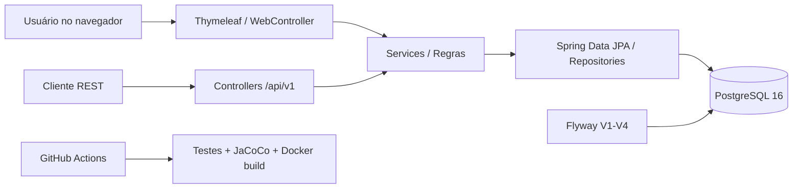

# Reaproveita+ — Etapa 11 | Documentação técnica

**Projeto:** Reaproveita+ — plataforma de redistribuição de alimentos  
**Instituição:** FIAP — Global Solution  
**Autor:** Marcus Vinicius de Souza Calazans — RM 556620  
**Referência de código:** [calazans-999/reaproveita-plus](https://github.com/calazans-999/reaproveita-plus), branch `main`, consultada em 06/11/2026.  
**Estado:** documentação preparada para revisão local; não equivale à entrega final nem ao deploy na Azure.

## 1. Resumo executivo
O Reaproveita+ é uma plataforma acadêmica para conectar organizações doadoras e receptoras, registrar disponibilização de alimentos, solicitar e acompanhar reservas e recomendar oportunidades a receptores elegíveis. O projeto utiliza Java 21, Spring Boot 4.1.2, Spring Security, Spring Data JPA, Thymeleaf, PostgreSQL 16 e Flyway. A API oferece autenticação HTTP Basic; a interface web usa login de formulário e sessões. O GitHub Actions automatiza a execução de testes e a construção da imagem Docker.

## 2. Objetivos e escopo
- Reduzir desperdício por meio do registro de doações e do encontro entre doadores e receptores.
- Representar organizações com localização e tipo (doadora ou receptora).
- Impor regras de negócio e acesso aos recursos de cada organização.
- Gerenciar estados de doações e reservas.
- Gerar recomendações explicáveis a partir de elegibilidade, distância e prazo.

**Fora do escopo comprovado:** pagamento, rastreamento GPS em tempo real, roteirização viária, previsão por IA treinada ou serviço publicado em produção na Azure. O algoritmo atual é determinístico, não um modelo de machine learning.

## 3. Tecnologias
| Camada | Tecnologia | Função |
|---|---|---|
| Backend | Java 21, Spring Boot 4.1.2 | API e regras de negócio |
| Interface | Thymeleaf, HTML/CSS | Páginas web |
| Persistência | Spring Data JPA, Hibernate | Mapeamento objeto-relacional |
| Banco | PostgreSQL 16 | Armazenamento relacional |
| Evolução de schema | Flyway (V1–V4) | Migrações versionadas |
| Segurança | Spring Security, BCrypt | Autenticação/autorização |
| Testes | JUnit / testes de integração | Regressão e fluxos HTTP |
| Cobertura | JaCoCo 0.8.16 | Cobertura de linhas e branches |
| Execução | Docker, Docker Compose | Ambiente local em containers |
| Automação | GitHub Actions | Testes, empacotamento e build Docker |

## 4. Arquitetura


A arquitetura separa controllers, services, repositories, modelos de domínio e DTOs. As regras de posse e transição ficam nos services e entidades. O `compose.app.yaml` executa apenas o app e conecta ao banco existente por `host.docker.internal:5434` no Docker Desktop para Windows.

## 5. Modelo de dados
| Entidade | Tabela | Campos e relacionamentos principais |
|---|---|---|
| User | `app_users` | `id`, `name`, `email` único, `password_hash`, `role`, `created_at` |
| Organization | `organizations` | `id`, `owner_id` → User, `name`, `type`, `city`, coordenadas, `verified` |
| Donation | `donations` | `id`, `organization_id` → Organization, título, categoria, kg, validade, conservação, declaração sanitária, status |
| Reservation | `reservations` | `id`, `donation_id` → Donation, `receiver_organization_id` → Organization, status, datas |
| ReceiverProfile | `receiver_profiles` | PK/FK `organization_id`, capacidade em kg, disponibilidade para retirada |
| Categorias aceitas | `receiver_profile_categories` | Organização receptora e categorias de alimentos aceitas |

Tipos de organização: `DONOR`, `RECEIVER`. Categorias de alimentos: `FRUITS`, `VEGETABLES`, `BAKERY`, `GRAINS`, `OTHER`. A existência de `verified` na entidade não significa que um processo de aprovação automatizado esteja implementado.

## 6. Fluxos e regras de negócio
### 6.1 Doação
A organização doadora cadastra uma doação com categoria, peso, validade, armazenamento e declaração sanitária. Os estados definidos no código são `AVAILABLE`, `RESERVED`, `COLLECTED`, `CANCELLED`, `EXPIRED` e `BLOCKED`; nem todos possuem uma transição automatizada exposta pela API. Atualizações dependem do estado `AVAILABLE`; uma doação vencida não pode ser atualizada/reservada segundo as validações de serviço. O cancelamento é tratado como operação específica.

### 6.2 Reserva
1. Uma organização receptora solicita uma reserva para uma doação `AVAILABLE`.
2. A doação muda para `RESERVED` e a reserva nasce `REQUESTED`.
3. O doador pode confirmar: `REQUESTED` → `CONFIRMED`.
4. O doador pode registrar a coleta: `CONFIRMED` → `COLLECTED`, atualizando também a doação para `COLLECTED`.
5. Uma reserva `REQUESTED` ou `CONFIRMED` pode ser cancelada segundo as permissões; a doação retorna para `AVAILABLE`.

Tentativas incompatíveis com o estado atual retornam conflito HTTP 409. O serviço bloqueia reservas de doações vencidas, sem declaração sanitária e de organizações que não sejam receptoras, entre outras validações.

### 6.3 Recomendações
O código considera doação elegível, perfil receptor disponível, categoria aceita, capacidade suficiente, coordenadas válidas, organizações distintas e distância **até 50 km em linha reta**. A classificação usa pontuação determinística de 0 a 100, aproximadamente:

`pontuação = 0,35 × proximidade + 0,30 × compatibilidade + 0,20 × urgência + 0,15 × disponibilidade`

Compatibilidade e disponibilidade valem 100 após os filtros binários. Urgência varia conforme horas até o vencimento: menos de 6 horas (100), menos de 24 (75), menos de 48 (50) e demais casos (25). Proximidade cai linearmente de 100 (0 km) para 0 (50 km). O retorno é ordenado por score decrescente e limitado a 20 resultados. Distância geográfica não representa tempo real de deslocamento.

## 7. Segurança
- **API `/api/**`:** HTTP Basic por requisição, sessão `STATELESS`, regras por autenticação e papéis.
- **Interface web:** login `/login`, sessão, logout `/logout` e proteção CSRF habilitada.
- **Papéis:** `ADMIN`, `DONOR`, `RECEIVER`.
- **Credenciais:** senhas de usuários armazenadas como hash BCrypt.
- **Acesso por organização:** os services aplicam restrição de posse, retornando frequentemente HTTP 404 a terceiros para não revelar recursos.
- **Erros:** `DispatcherType.ERROR` e `/error` liberados na cadeia web para preservar status HTTP 401/403.

**Nota de segurança para produção:** o `application.yml` versionado contém um valor padrão de senha de desenvolvimento (`DB_PASSWORD`) e pressupõe infraestrutura local. Na Azure, retirar defaults sensíveis, definir segredos reais por configuração protegida e usar HTTPS; não incluir arquivos `.env`, dumps ou credenciais nas evidências.

## 8. API REST
Ver tabela completa em [API_ENDPOINTS.md](API_ENDPOINTS.md). O prefixo principal é `/api/v1`; o health Spring Actuator está em `/actuator/health`.

## 9. Interface web
Páginas HTML/rotas: `/login`, `/register`, `/dashboard`, `/organizations`, `/donations`, `/reservations`, `/recommendations`. A interface web utiliza o mesmo domínio de serviços da API, com formulários e navegação Thymeleaf. As rotas protegidas exigem sessão autenticada.

## 10. Estratégia de testes e métricas
**Evidência informada da Etapa 9 em 06/11/2026:** 42 testes, 0 falhas, 0 erros, cobertura JaCoCo **89,17% de linhas**; 43 classes analisadas. Este percentual não prova 89,17% de cobertura de requisitos nem de branches. O log da Etapa 10 comprovou Docker build, app iniciando, health `UP` e `/login` HTTP 200. A captura do GitHub Actions mostrou execução verde de aproximadamente 1m39s; os artefatos da execução remota devem ser anexados se exigidos pela FIAP.

Comando de reprodução:
```powershell
.\mvnw.cmd clean org.jacoco:jacoco-maven-plugin:0.8.16:prepare-agent test org.jacoco:jacoco-maven-plugin:0.8.16:report
Start-Process target\site\jacoco\index.html
```

## 11. DevOps
O `Dockerfile` possui build multi-stage: Maven/Java 21 para empacotar e Temurin Java 21 JRE para executar. A imagem final usa usuário não privilegiado e expõe a porta 8082. O `compose.app.yaml` usa o PostgreSQL local existente, sem recriá-lo. O workflow `.github/workflows/ci.yml` usa PostgreSQL 16 de serviço na porta 5434, Java 21, testes/JaCoCo, JAR, Docker build e upload de relatórios/JAR (retenção de 14 dias). **CI executada com sucesso; publicação automática e CD para Azure não implementadas.**

## 12. Preparação Azure
Destinos planejados: Azure App Service para container, registro de imagem (ex.: ACR) e Azure Database for PostgreSQL. O arquivo `docs/AZURE_PREPARACAO.md` registra a preparação da Etapa 10. Não há comprovação de deployment remoto, URL pública, infra provisionada para este projeto ou custos. Uma eventual implantação exige avaliar permissões/cotas, TLS, firewall, variáveis de ambiente e `WEBSITES_PORT=8082`.

## 13. Limitações e próximos passos
- Entrega técnica atual baseada em aplicação acadêmica validada localmente e CI verde.
- Preparar evidências visuais de UI e relatório de testes para a apresentação.
- Validar operacionalmente o fluxo ponta a ponta com usuários reais de teste e capturas.
- Não registrar Azure como implantada até validação remota.
- Avaliar requisitos de privacidade, logística, segurança alimentar e tratamento de dados em cenário real.

## 14. Reprodutibilidade e referências internas
Repositório: https://github.com/calazans-999/reaproveita-plus  
Workflow: https://github.com/calazans-999/reaproveita-plus/actions  
Arquivos principais: `pom.xml`, `SecurityConfig.java`, controllers REST, `DonationService.java`, `ReservationService.java`, `RecommendationService.java`, `Dockerfile`, `compose.app.yaml`, `.github/workflows/ci.yml`, migrations Flyway.
