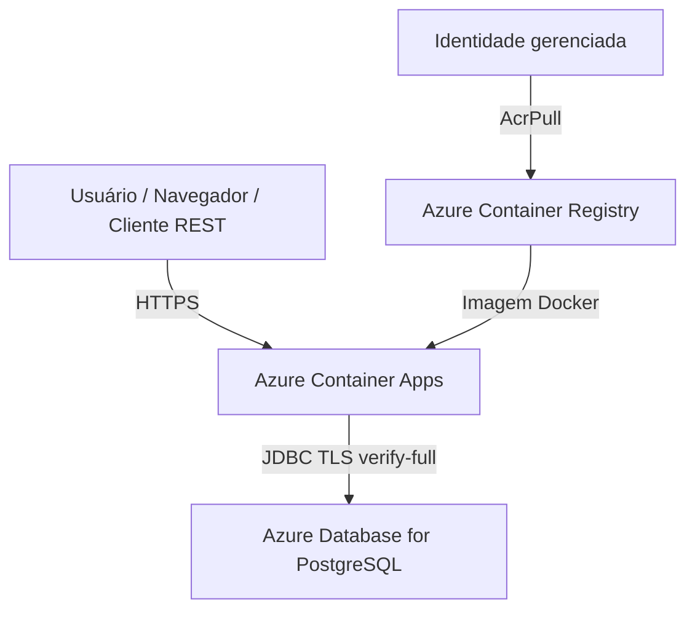


# Reaproveita+ — Implantação Azure

**Projeto:** FIAP Global Solution 2026 — CitizenTech  
**Responsável:** Marcus Vinicius de Souza Calazans — RM 556620  
**Data da validação:** 17/11/2026  
**Repositório:** https://github.com/calazans-999/reaproveita-plus  
**Branch:** main  
**Commit de referência:** a3d2198

## 1. Objetivo

Documentar a implantação do Reaproveita+ na Microsoft Azure, incluindo arquitetura, configurações, segurança, testes funcionais, resultados e limitações identificadas.

O Reaproveita+ conecta organizações doadoras e receptoras de alimentos, oferecendo cadastro de doações, reservas, controle de retirada e recomendações por compatibilidade.

## 2. Endereço público

https://reaproveita-plus-app.delightfulocean-71f5cddf.francecentral.azurecontainerapps.io

Endpoint de saúde:
GET /actuator/health

Endpoint de prontidão:
GET /actuator/health/readiness

Os endpoints retornaram status UP na validação de 17/11/2026.

## 3. Arquitetura implantada

### Recursos Azure

| Recurso | Identificação |
|---|---|
| Grupo de recursos | rg-reaproveita-gs |
| Região | France Central |
| Container App | reaproveita-plus-app |
| Ambiente Container Apps | env-reaproveita-gs |
| Container Registry | acrreaproveitacalazans |
| Imagem | reaproveita-plus:etapa13-tls |
| PostgreSQL Flexible Server | pg-reaproveita-calazans |
| Banco de dados | reaproveita |
| Identidade gerenciada | id-reaproveita-acr |

O projeto utilizou Azure Container Apps porque não foi possível provisionar o App Service planejado originalmente, devido à limitação de quota identificada durante a implantação.

## 4. Tecnologias

- Java 21
- Spring Boot 4.1.2
- Spring Security
- Spring Data JPA e Hibernate
- PostgreSQL 16
- Flyway
- Docker multi-stage
- Azure Container Apps
- Azure Container Registry
- Azure Managed Identity
- GitHub Actions
- JUnit, Maven Surefire e JaCoCo

## 5. Configuração do contêiner

A aplicação utiliza uma imagem Docker baseada em Java 21.

Configurações verificadas:

| Parâmetro | Valor |
|---|---|
| Porta interna | 8082 |
| CPU | 0,5 vCPU |
| Memória | 1 GiB |
| Réplicas mínimas | 1 |
| Réplicas máximas | 1 |
| Workload profile | Consumption |
| Acesso externo | Habilitado |
| HTTP inseguro | Desabilitado |

O Dockerfile utiliza usuário sem privilégios administrativos e inclui certificados públicos necessários para validar a conexão TLS com o PostgreSQL.

A imagem é armazenada no Azure Container Registry e acessada pelo Container Apps por identidade gerenciada com permissão AcrPull.

## 6. Banco de dados e persistência

Banco: Azure Database for PostgreSQL Flexible Server 16.

A aplicação utiliza Spring Data JPA para persistência e Flyway para controle de migrações.

A inicialização na Azure confirmou:
- Conexão PostgreSQL estabelecida.
- Pool Hikari inicializado.
- Quatro migrações Flyway validadas.
- Schema public na versão 4.
- Aplicação Spring Boot iniciada na porta 8082.

A conexão JDBC utiliza TLS com `sslmode=verify-full` e um arquivo de certificados públicos.

As credenciais são fornecidas por variáveis de ambiente e referência a segredo do Container Apps. Senhas não devem ser publicadas no repositório.

## 7. Segurança

Foram validados:
- HTTPS externo.
- HTTP inseguro desabilitado.
- Autenticação HTTP Basic para a API.
- Regras de acesso por usuário proprietário.
- Bloqueio de consultas a recursos privados de outros usuários.
- Uso de identidade gerenciada para acesso ao ACR.
- Validação TLS da conexão com PostgreSQL.

### Limitação de rede pendente

O PostgreSQL permanece com acesso público habilitado.

A regra de firewall temporária `teste-containerapps-azure`, configurada como `0.0.0.0`, permite tentativas de conexão provenientes de serviços hospedados no Azure, inclusive de outras assinaturas.

Essa configuração foi utilizada para viabilizar a comunicação no ambiente de demonstração.

Antes de uso em produção, deve ser substituída por uma arquitetura de acesso mais restritiva, preferencialmente com rede privada, além de revisão de credenciais, backups, monitoramento e custos.

A implantação atual não deve ser apresentada como ambiente de produção totalmente protegido.

## 8. Testes funcionais realizados na Azure

| Cenário | Resultado |
|---|---|
| Health e readiness | UP |
| Cadastro de usuário DONOR | Aprovado |
| Cadastro de usuário RECEIVER | Aprovado |
| Autenticação HTTP Basic | Aprovado |
| Cadastro de organização doadora | Aprovado |
| Cadastro de organização receptora | Aprovado |
| Criação de doação | Aprovado |
| Listagem e filtro por categoria | Aprovado |
| Cadastro e consulta de perfil receptor | Aprovado |
| Recomendações para receptor | Aprovado |
| Recomendações para doador | Aprovado |
| Solicitação de reserva | Aprovado |
| Confirmação pelo doador | Aprovado |
| Registro de retirada | Aprovado |
| Cancelamento de reserva | Aprovado |
| Cancelamento de doação | Aprovado |
| Bloqueio de reserva duplicada | HTTP 409 |
| Recurso inexistente | HTTP 404 |
| Acesso sem autenticação | HTTP 401 |
| Consultas privadas por usuários sem permissão | HTTP 404 |

## 9. Evidência das recomendações

Uma doação fictícia de 12,5 kg de alimentos da categoria BAKERY foi associada a uma organização receptora com capacidade de 20 kg.

O algoritmo retornou:

- Pontuação: 84/100.
- Distância aproximada: 0,84 km em linha reta.
- Categoria aceita.
- Capacidade suficiente.
- Disponibilidade para retirada.

O algoritmo é determinístico, baseado em regras e pontuação. Não utiliza um modelo de machine learning ou IA generativa.

## 10. Ciclo de vida da doação

O fluxo completo foi validado:

1. Doação criada como AVAILABLE.
2. Reserva solicitada como REQUESTED.
3. Doação alterada para RESERVED.
4. Reserva confirmada como CONFIRMED.
5. Retirada registrada como COLLECTED.
6. Doação alterada para COLLECTED.

Também foi realizado teste separado de cancelamento de reserva e cancelamento de doação.

Os dados utilizados foram fictícios.

## 11. Disponibilidade e diagnóstico

Durante os testes, ocorreram respostas HTTP 503 intermitentes.

Foi identificada configuração inicial de zero réplicas mínimas no Container Apps, permitindo scale to zero.

O mínimo foi alterado de 0 para 1 réplica.

Após a atualização, foram verificados:
- Revisão Healthy.
- Estado Running.
- Provisionamento Provisioned.
- Uma réplica em execução.
- Contêiner ready=true.
- Health UP.
- Readiness UP.
- Acesso autenticado funcionando.
- Dados persistidos disponíveis.

A configuração de escala pode reduzir inicializações a frio, mas a causa de todas as ocorrências anteriores de HTTP 503 não foi comprovada definitivamente.

Manter uma réplica mínima pode gerar custos contínuos na assinatura Azure.

## 12. Testes automatizados

As evidências locais da Etapa 9 registraram:
- 42 testes aprovados.
- Zero falhas e erros.
- Cobertura JaCoCo de linhas: 89,17%.

Esses resultados são históricos e devem ser acompanhados por nova execução antes da entrega final.

## 13. Versionamento

Repositório:
https://github.com/calazans-999/reaproveita-plus

Commit utilizado para documentar as alterações Docker e TLS:
a3d2198

Arquivos de configuração sensíveis e backups locais não devem ser incluídos no Git.

## 14. Melhorias futuras

- Substituir a regra temporária de firewall por conectividade privada.
- Revisar monitoramento, alertas e recuperação de falhas.
- Validar rotina de backup e restauração.
- Monitorar consumo dos créditos Azure.
- Adotar estratégia de atualização e rollback.
- Ampliar testes de desempenho e disponibilidade.
- Avaliar integração adicional de IA, se exigida pelo escopo acadêmico.

## 15. Conclusão

A implantação funcional do Reaproveita+ na Azure foi validada com autenticação, persistência PostgreSQL, doações, recomendações, reservas e retirada.

O sistema atende ao fluxo acadêmico demonstrado, permanecendo pendentes melhorias de segurança de rede e endurecimento operacional antes de qualquer utilização em produção.
